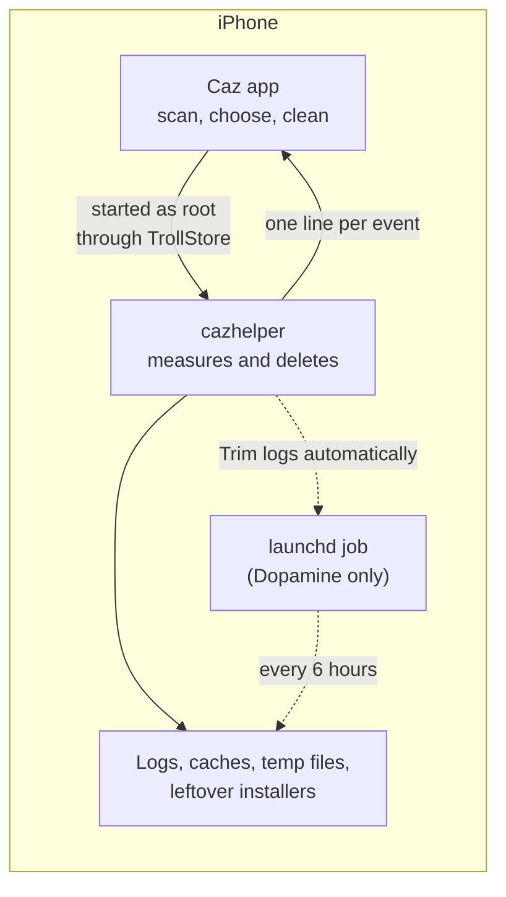
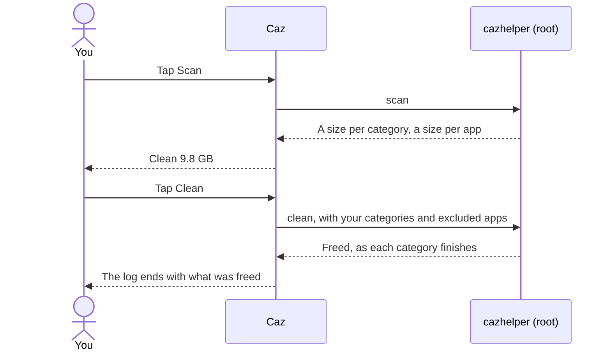
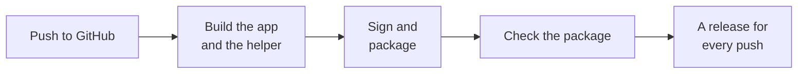

<p align="center">
  
</p>

<h1 align="center">Caz</h1>

<p align="center">
  <b>Find and clear the storage iOS never cleans up.</b><br>
  System logs, abandoned downloads, app caches and leftover installers, measured first and removed in one tap.
</p>

<p align="center">
  <a href="https://github.com/m9z2w4d8vw-blip/Caz/actions/workflows/build.yml"></a>
  <a href="https://github.com/m9z2w4d8vw-blip/Caz/releases/latest"></a>
  
  
  
</p>

<p align="center">
  <a href="#quick-start"><b>Quick start</b></a> &nbsp;·&nbsp;
  <a href="#using-caz"><b>Using Caz</b></a> &nbsp;·&nbsp;
  <a href="#troubleshooting"><b>Troubleshooting</b></a> &nbsp;·&nbsp;
  <a href="#how-it-works"><b>How it works</b></a> &nbsp;·&nbsp;
  <a href="#building-and-testing"><b>Building</b></a>
</p>

---

iOS only clears app caches when storage is nearly full, and some things it never clears at all. That includes the
diagnostic log archive, downloads that never finished, temp copies Photos makes when you share, and installers left in
app inboxes. On a jailbroken phone, leftovers from earlier setups pile up on top. Caz measures all of it, shows you the
size of each category, and removes what you choose.

**Status:** in use on an iPhone 13 running iOS 17.0. The root helper, which does all the measuring and deleting, is
also tested against a rebuilt copy of a real iPhone's file system.

> [!WARNING]
> Caz deletes files as root, and deleted files can't be restored. It only touches the paths listed in
> [What Caz touches](#what-caz-touches), never follows symlinks, and skips files that are still in use. Photos,
> messages, music and app documents are never part of a clean.

## Highlights

| | |
| --- | --- |
| 🎨 **Dopamine-style interface** | The menu, the button that opens into a live log, and the windows follow Dopamine's design, in Caz's yellow. |
| 🔍 **Scan first, then choose** | Every category shows its size before anything is deleted. Turn categories, or single apps, off. |
| 🧹 **One-tap clean** | **Clean** opens into a log that checks off each category as it finishes. |
| 🧾 **System logs under control** | Clears the diagnostic log archive without a reboot, and can keep it to a day's worth (Dopamine). |
| ⬇️ **Updates itself** | When a newer release is on GitHub, **Update Available** shows the changelog and installs it, like Dopamine. |
| 🛡️ **Careful by design** | A fixed list of paths, no symlinks followed, files in use left alone, SpringBoard and Jetsam reports kept. |
| 📦 **Leftovers too** | Abandoned downloads, IPAs left in app inboxes, and temp copies that Photos and other apps never deleted. |

## Requirements

| | |
| --- | --- |
| **iPhone** | iOS 17.0, arm64. Built for an iPhone 13. |
| **TrollStore** | Required. On iOS 17 that means 17.0, the last version TrollStore supports. |
| **Jailbreak** | Optional. Rootless Dopamine adds **Trim logs automatically**. Everything else works without it. |

## Quick start

1. **Download** `Caz.tipa` from the [**latest release**](https://github.com/m9z2w4d8vw-blip/Caz/releases/latest). A new
   one is published on every push to `main`; `SHA256SUMS` lets you verify the files. After that, Caz updates itself.
2. **Install.** Open `Caz.tipa` with TrollStore. `Caz.ipa` is the same file under another name.
3. **Scan.** Open Caz and tap **Scan** in the menu. Nothing is deleted yet; every category gets a size.
4. **Choose and clean.** Turn off anything you want to keep in **Categories** or **App Caches**, then tap
   **Clean** at the bottom. It shows the total.
5. **Optional.** On a Dopamine jailbreak, turn on **Settings > Trim logs automatically**.

> [!NOTE]
> Caz needs TrollStore. Sideloading it with AltStore or Sideloadly installs it, but strips the permissions it needs to
> start its root helper, so it can't measure or delete anything.

> [!TIP]
> **Maps tiles** and **Leftover installers** start switched off. Leave Maps off if you use offline maps, and check
> which installers you still want before turning that category on.

<details>
<summary><b>Uninstalling</b></summary>

<br>

If **Trim logs automatically** is on, turn it off first, so the background job is removed. Then delete Caz like any
other app. If Caz is already gone, remove the job by hand:

```sh
sudo launchctl unload /var/jb/Library/LaunchDaemons/com.parv.caz.logtrim.plist
sudo rm /var/jb/Library/LaunchDaemons/com.parv.caz.logtrim.plist
```

</details>

## Using Caz

### The main screen

The layout follows Dopamine's: the name and two lines at the top, a menu in the middle, and one big button at the
bottom.

- **The lines under the name** show the iOS version, then the author. If something's wrong, such as Caz not having
  root access, the second line says so instead.
- **The menu** has the same four-row layout as Dopamine's: **Settings**, **Scan**, **App Caches** and **Categories**.
  Settings, App Caches and Categories open as windows in the middle of the screen; tap outside a window to close it.
  **Scan** measures every category; scan again any time to refresh the sizes.
- **The big button** always cleans. It's greyed out until a scan finds something, then reads **Clean 9.8 GB**.
  Tapping it folds the menu away and opens the button into a log: each category appears as a line, gets a
  checkmark when it's done, and the last line shows the total. The button folds back on its own.
- **App Caches** lists every app's cache after a scan, with each app's icon, so you can tell exactly whose cache
  you're clearing and keep single apps. **Categories** lists every category with its size and a switch.

### Updates

Caz checks this repository's releases when it opens, the way Dopamine checks its own. When there's a newer version,
**Update Available** slides in above **Clean**.

1. Tap it to see the **changelog**: every release since yours, newest first.
2. Tap **Update**. Caz downloads the new `Caz.tipa` with a progress ring, then hands it to TrollStore to install.
   Caz closes when TrollStore replaces it; open it again.
3. If TrollStore's installer can't be reached, Caz asks TrollStore to install it from the link instead, and without
   TrollStore it opens the releases page.

### What gets cleaned

| Category | Clears | Comes back? | Default |
| --- | --- | --- | --- |
| **System logs** | The diagnostic log archive (`.tracev3` files) | Within days, as iOS logs | On |
| **Abandoned downloads** | Download temp files untouched for an hour | Only if a download keeps failing | On |
| **Crash reports** | Crash, hang and analytics reports | With the next crash | On |
| **System caches** | Symbol, Memoji and QuickLook caches; temp copies | Slowly, as needed | On |
| **App caches** | Each app's cache and temp folders, and in-app browser caches | As you use the apps | On |
| **Messages previews** | Attachment thumbnails (not the attachments) | As you scroll through chats | On |
| **Maps tiles** | The Apple Maps tile cache | As you browse the map | Off |
| **Leftover installers** | `.ipa`, `.tipa` and `.deb` files left in app inboxes | No | Off |

> [!TIP]
> Some apps keep downloads in their cache folder. Caz checks which of these are installed and handles them:
>
> | App | What Caz does |
> | --- | --- |
> | Spotify | Never touched: it keeps downloaded songs in its cache. Listed under **Skipped**. |
> | YouTube | Off by default: its cache may hold downloaded videos. Switch it on in **App Caches** if you don't use downloads. |
> | TikTok | Cleaned, but its draft media and offline videos stay. |
> | Strava | Cleaned, but its offline maps stay. |
> | Google Maps | Cleaned, but its offline areas stay. |
>
> If another app loses offline content after a clean, turn it off in **App Caches**; Caz remembers.

### Settings

| Setting | Default | What it does |
| --- | --- | --- |
| **Keep SpringBoard and Jetsam reports** | On | Crash reports for SpringBoard and memory pressure stay, for debugging tweaks and resprings |
| **Close apps before clearing their caches** | On | Force-closes the apps whose caches are about to be cleared |
| **Trim logs automatically** | Off | Every 6 hours, deletes log files older than a day. Needs Dopamine |

**View Log**, at the bottom of Settings, shows every line from the last scan or clean.

## Troubleshooting

| Symptom | Likely cause | What to do |
| --- | --- | --- |
| The line under the name reads *Caz couldn't get root access. Install it with TrollStore.* | Caz wasn't installed with TrollStore, so its helper can't start as root | Install `Caz.tipa` with TrollStore. |
| The line under the name reads *The root helper is missing from the app.* | The build didn't include `cazhelper` | Use a release build, or open the run's **Check the package** step. |
| Lines in **View Log** start with `!` | Some files were in use or protected | Close the apps involved and clean again. |
| *Freed* is less than the scan showed | Files changed or were in use between the scan and the clean | Normal for caches being written to. Scan again to see what's left. |
| The space comes back within days | Logs and app caches refill as you use the phone | Turn on **Trim logs automatically**. If one app refills fast, the cause is that app. |
| **Trim logs automatically** is greyed out | No Dopamine jailbreak was found | It needs rootless Dopamine; the rest of Caz works without it. |
| An app lost offline content | It keeps downloads in its cache folder | Turn that app off in the **App caches** list. |
| Map tiles load slowly afterwards | The tile cache is rebuilding | It refills as you browse. Leave **Maps tiles** off if it bothers you. |

When something looks wrong, open **Settings > View Log**. It shows every category, every count and every error.

## How it works



A normal app is sandboxed and can't read or delete system files. Caz bundles a small C program, `cazhelper`, and
starts it as root through TrollStore's persona spawn, the same way other TrollStore apps do. The app never touches the
file system itself; it sends the helper a command and shows the lines that come back.

A scan and a clean work like this:



<a id="what-caz-touches"></a>
<details>
<summary><b>What Caz touches, the safety rules, and the helper's protocol</b></summary>

<br>

**What Caz touches.** Nothing outside this list. Every path is under `/private/var`.

| Category | Paths | Rule |
| --- | --- | --- |
| System logs | `db/diagnostics` | `.tracev3` files untouched for 2 minutes. `db/uuidtext` is kept, so no reboot is needed |
| Abandoned downloads | `mobile/Library/Caches/com.apple.nsurlsessiond/Downloads`, `tmp`, and each container's `tmp`, `Documents` and background download folder | `CFNetworkDownload_*.tmp` untouched for an hour |
| Crash reports | `mobile/Library/Logs/CrashReporter`, `logs/CrashReporter`, `root/Library/Caches/hangtracerd`, the analytics `DiagnosticReports` | With the setting on, `SpringBoard*`, `JetsamEvent*` and `panic*` stay |
| System caches | `com.apple.coresymbolicationd`, `com.apple.AvatarKit`, `com.apple.QuickLook.thumbnailcache`, `mobile/tmp/MediaCache`, the media analysis poster copies, `mobile/Media/PublicStaging`, TrollFools' temp folders, Photos' `photospicker` and `draganddrop` copies | Folder contents |
| App caches | Each app's `Library/Caches`, `tmp` and in-app browser cache; apps inside LiveContainer; extensions | Spotify and Caz are always skipped. TikTok's `offline-mode` and `com.studio.album.importToEdit`, Strava's `offline` and `mapdownloads`, and Google Maps' `OfflineData` stay |
| Messages previews | `mobile/Library/Caches/com.apple.MobileSMS/Previews` | Messages is closed first |
| Maps tiles | `com.apple.geod/MapTiles`, `GeoServices` | Maps is closed first; the tile service restarts after |
| Leftover installers | `Documents/Inbox` of each app and jailbreak app | `.ipa`, `.tipa`, `.deb` untouched for an hour |

**Safety rules** (all in `RootHelper/main.c`):

- symlinks are never followed, and a walk never crosses into another volume;
- a path that would be cut off is treated as missing, never shortened;
- the folders themselves stay; only their contents go;
- apps are found by the bundle ID in their container's metadata, never by guessing.

**The protocol.** The helper prints one tab-separated line per event:

| Line | Meaning |
| --- | --- |
| `LOG <text>` | A line for the log panel |
| `ERR <text>` | Something went wrong; shown with a `!` |
| `CAT <category> <bytes> <files>` | Scan result for one category |
| `APP <bundle id> <bytes> <name> <note>` | Scan result for one app's caches; the note says what's kept |
| `SKIP <bundle id> <bytes> <name> <reason>` | An installed app whose cache is never touched |
| `FREED <category> <bytes> <files> <errors>` | Clean result for one category |
| `AUTOTRIM on\|off\|unavailable` | State of the log-trim job |

**Updates** use `cazhelper install-update <path>`: it finds TrollStore's installer (`trollstorehelper`, inside
`TrollStore.app`) by its bundle ID and runs it in its own session, so the install finishes even when it closes Caz.
The helper only accepts a `.tipa` or `.ipa` inside `/var/mobile`.

**The log-trim job** is `/var/jb/Library/LaunchDaemons/com.parv.caz.logtrim.plist`. It runs
`find /private/var/db/diagnostics -name '*.tracev3' -mmin +1440 -delete` at load and every 6 hours. Turning the
setting off also removes the older hand-made `com.parv.logtrim` job, if there is one.

</details>

## Repository layout

```text
.
├── Caz/                       the SwiftUI app
│   ├── CleanerModel.swift         state, settings, the log, and the helper protocol
│   ├── ContentView.swift          the main screen: header, menu, the button and its log
│   ├── MainComponents.swift       header, menu rows, the button, the lyrics log, spinners
│   ├── Windows.swift              Categories, App Caches, Settings and the log
│   ├── Theme.swift                colours, metrics and the backdrop
│   ├── RootSpawn.h/.m             starts the helper as root
│   ├── UpdateModel.swift          checks GitHub releases, downloads and installs updates
│   ├── UpdateViews.swift          the changelog, the download ring and the update buttons
│   ├── AppIcons.h/.m              looks up app icons for the App Caches list
│   ├── Resources/                 LICENSE-Dopamine.txt and the wordmark font
│   └── Assets.xcassets            the app icon, the yellow backdrop and the title
├── RootHelper/                cazhelper (C) and its entitlements
├── Config/                    Info.plist and the app's entitlements
├── scripts/package.sh         signs both binaries and packages Caz.tipa and Caz.ipa
├── scripts/make_wordmark.py   draws the title image from the Fonarto font file
├── docs/images/               images for this README
├── project.yml                XcodeGen spec (the .xcodeproj is generated, not committed)
└── .github/workflows/         CI: build, check, publish
```

## Credits

Caz's interface is based on [Dopamine](https://github.com/opa334/Dopamine)'s, by Lars Fröder (opa334), used under
the MIT License, which ships inside the app bundle and in `Caz/Resources/LICENSE-Dopamine.txt`. Caz starts its root helper the way TrollStore apps do.

Dopamine's title is a picture, not live text: `Dopamine.imageset` holds it at 1x, 2x and 3x, drawn in Fonarto
Regular. Caz's title works the same way. `Caz/Assets.xcassets/Wordmark.imageset` holds "Caz" drawn in
[Fonarto](https://www.fontspace.com/fonarto-2-font-f104632) Regular with the letter spacing measured from Dopamine's
title (-0.65% of the em), shown 40 pt tall like Dopamine's. The font file itself isn't shipped, only the picture.
Fonarto is by Locomotype (Arwan Sutanto) and is free for personal and commercial use.

To redraw it, run `scripts/make_wordmark.py` with the font file (it needs Pillow). If the image is ever missing, Caz
uses the first `.ttf` or `.otf` in `Caz/Resources`, then SF Rounded Bold.

## Building and testing



Every push runs `.github/workflows/build.yml` on macOS with Xcode 16.4. The build job does five things:

1. generates the Xcode project with XcodeGen;
2. builds the app with `xcodebuild` and the helper with `clang`;
3. signs both with `ldid`, using their entitlements, and packages `Caz.tipa` and `Caz.ipa`;
4. checks the package: both binaries, their entitlements, the icon, the bundled Dopamine license and the version;
5. uploads it as the `Caz-app` artifact.

Each push to `main` then publishes a full release named after its version (`1.0.57`, tag `v1.0.57`) with both files
and `SHA256SUMS`. Its notes are the commit messages of that push, which is what the in-app changelog shows. Caz's
updater ignores pre-releases, as Dopamine's does. Versions are `MARKETING_VERSION` from `project.yml` plus the run
number, so every build is newer than the last; keep `MARKETING_VERSION` to two parts. Pushing a tag such as `v1.2.0`
publishes that tag instead; bump `MARKETING_VERSION` to `1.2` afterwards so later builds stay newer.

<details>
<summary><b>Building on a Mac, and testing the helper on any computer</b></summary>

<br>

You need macOS with Xcode, [XcodeGen](https://github.com/yonaskolb/XcodeGen) and `ldid` (`brew install xcodegen ldid`):

```sh
xcodegen generate
xcodebuild -project Caz.xcodeproj -scheme Caz -configuration Release -sdk iphoneos \
  -destination 'generic/platform=iOS' -derivedDataPath build/DerivedData \
  CODE_SIGNING_ALLOWED=NO build
xcrun --sdk iphoneos clang -arch arm64 -mios-version-min=17.0 -O2 \
  -framework CoreFoundation -o build/cazhelper RootHelper/main.c
bash scripts/package.sh            # build/Caz.tipa and build/Caz.ipa
```

The helper also builds on Linux or macOS in a test mode, where every path is prefixed with `CAZ_ROOT`. Point it at a
copy of a file tree and it scans and cleans that instead of the real system:

```sh
gcc -DCAZ_TEST -std=c11 -D_DEFAULT_SOURCE -O2 -Wall -o cazhelper_test RootHelper/main.c
CAZ_ROOT=/path/to/fake/root ./cazhelper_test scan --keep-sb
CAZ_ROOT=/path/to/fake/root ./cazhelper_test clean logs,downloads --keep-sb
```

</details>
